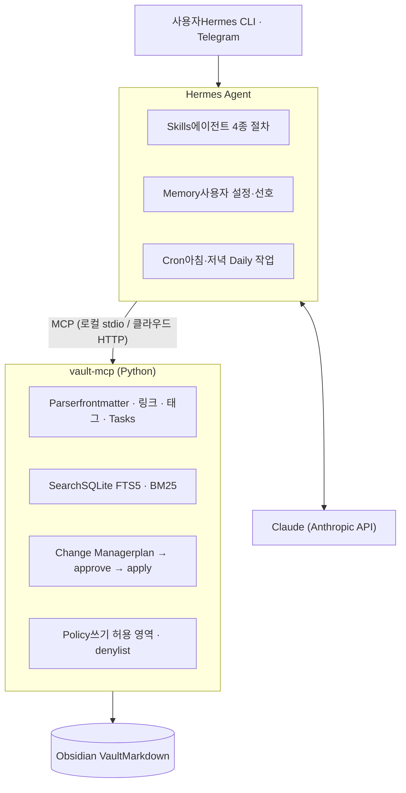

# Obsidian AI Knowledge Agent

> 기록은 내가, 정리와 검색은 AI가.

Obsidian Vault에 쌓인 일상·업무·학습 기록을 **AI가 정리하고 연결하고 찾아 주는** 개인 지식관리 에이전트입니다.
[Hermes Agent](https://hermes-agent.nousresearch.com/docs)를 런타임으로, Claude를 LLM으로 사용하며 Vault 접근은 모두 Python MCP 서버(`vault-mcp`)를 거칩니다.

> **상태: 개발 초기 단계 (2026-11)** — Vault 구조 정비를 마쳤고, `vault-mcp`와 에이전트 Skill을 만드는 중입니다. 아래 기능과 명령어는 계획이며 구현되는 대로 체크합니다.

---

## 왜 만드나

Obsidian에 기록은 많이 하지만 정리는 미루게 되고, 키워드가 기억나지 않으면 과거 기록을 다시 찾기 어렵습니다.

- 날짜마다 복사되는 미완료 할 일이 쌓여 무엇이 남았는지 알기 어렵다
- 새 메모를 어느 PARA 폴더에 둘지 매번 고민한다
- 비슷한 문서가 여러 곳에 흩어지고, 링크가 연결되지 않는다

이 에이전트는 기존 Obsidian 사용 방식(Markdown, 폴더 체계, Daily Note 템플릿, Tasks 플러그인 문법)을 바꾸지 않고, 그 위에서 정리·연결·검색을 대신합니다.

## 핵심 원칙

- **읽기는 자유, 쓰기는 승인 후** — 기존 문서의 수정·이동은 항상 `계획(Diff) → 사용자 승인 → 반영` 순서를 거칩니다. 자동으로 쓰는 곳은 Daily Note의 `## 요약` 섹션뿐입니다.
- **기록에 없는 내용은 만들지 않음** — 모든 답변과 추천에 원본 노트 경로를 붙이고, 근거가 없으면 "확인 불가"라고 답합니다.
- **민감한 폴더는 보내지 않음** — denylist 폴더와 `ai: false` 속성이 붙은 노트는 색인·검색·LLM 전송에서 제외합니다.
- **Vault 로직은 MCP 서버 하나에** — 승인 규칙·denylist·변경 기록을 한 곳에서 강제하고, 로컬(stdio)과 클라우드(HTTP)에서 같은 서버를 씁니다.

## 기능

| 에이전트 | 명령어 | 하는 일 | 쓰기  | 상태  |
| --- | --- | --- | --- | --- |
| Second Brain Setup | `/brain-setup`, `/brain-inbox`, `/brain-review` | 폴더·번호 규칙 점검, 깨진 링크·고아 노트·MOC 누락 리포트, Inbox 노트의 PARA 위치 제안 | 승인 후 | ⬜   |
| Daily Note | `/daily-start`, `/daily-close` | 오늘 노트 생성, 최근 30일 미완료 작업을 중복 없이 모아 원본 링크와 함께 정리, 하루 요약 | 자동 (`## 요약`만) | ⬜   |
| PARA Knowledge | `/para-organize` | 재사용할 지식 추출, PARA 위치 추천, 유사·중복 노트 탐지, 링크·MOC 항목 추천 | 승인 후 | ⬜   |
| Vault Q&A | `/vault-ask` | 자연어 질문에 여러 노트를 종합해 답하고 출처 표시 | 없음 (읽기 전용) | ⬜   |

방법론: **PARA**(Projects · Areas · Resources · Archive) + **CODE**(Capture → Organize → Distill → Express)

## 아키텍처



- **Hermes Agent**: 요청 이해, Skill 실행, 예약 작업(cron), 텔레그램 게이트웨이
- **vault-mcp**: Markdown 파싱, 검색 색인, 변경 계획·적용, 정책 강제
- **Claude**: 요약·분류·질의응답
- **Vault**: 기록의 원본. 에이전트 메모리에는 설정과 선호만 저장합니다.

## 프로젝트 구조 (예정)

```
Obsidian_AI_Agent/
├─ vault_mcp/            # Python MCP 서버
│  ├─ server.py          # FastMCP 엔트리 (stdio / HTTP)
│  ├─ parser.py          # frontmatter, [[링크]], 태그, Tasks 문법
│  ├─ index.py           # SQLite FTS5 색인, 파일 변경 감지
│  ├─ search.py          # BM25, 유사도, 미완료 작업 중복 묶음
│  ├─ changes.py         # plan / apply / revert, Diff 생성
│  └─ policy.py          # 쓰기 허용 영역, denylist, 색인 제외
├─ skills/               # Hermes Skills (agentskills.io 형식)
│  ├─ brain-setup/SKILL.md
│  ├─ daily-note/SKILL.md
│  ├─ para-organize/SKILL.md
│  └─ vault-ask/SKILL.md
├─ config/
│  ├─ vault.example.yaml
│  └─ vault.local.yaml   # 개인 설정 (git 제외)
├─ tests/                # 샘플 Vault + pytest
├─ deploy/               # Dockerfile, docker-compose (클라우드 단계)
└─ docs/
```

## 시작하기 (예정)

### 요구 사항

- Windows 10/11 (macOS·Linux·WSL2도 가능)
- Python 3.11+
- [Hermes Agent](https://hermes-agent.nousresearch.com/docs)
- Anthropic API 키
- Obsidian Vault (권장 플러그인: Dataview, Tasks)

### 설치

```powershell
# 1. Hermes Agent 설치 (Windows PowerShell)
iex (irm https://hermes-agent.nousresearch.com/install.ps1)

# 2. 저장소와 의존성
git clone https://github.com/<your-id>/Obsidian_AI_Agent.git
cd Obsidian_AI_Agent
python -m venv .venv
.venv\Scripts\activate
pip install -e .
```

### 설정

`config/vault.example.yaml`을 `config/vault.local.yaml`로 복사해 Vault 경로를 적습니다.

```yaml
vault_path: "D:/obsidian/my-vault"
daily:
  folder: "00. Daily"
  format: "YYYY/YYYY-MM-DD dd"      # Daily Notes 플러그인 설정과 동일하게
  template: "998.Template/Daily 템플릿"
  agent_section: "## 요약"          # 에이전트가 자동으로 쓰는 유일한 섹션
denylist:                           # 색인·검색·LLM 전송 제외
  - "04. Resource/Personal"
index_exclude:
  - ".obsidian"
  - "100.Canvas"
  - "200.Excalidraw"
  - "998.Template"
  - "999.Attached"
```

Hermes에 MCP 서버와 Skill을 등록합니다.

```bash
hermes mcp add vault --command "python -m vault_mcp.server --config config/vault.local.yaml"
hermes mcp test vault
```

### 사용 예

```
/daily-start
→ 오늘 노트를 만들고, 최근 30일 미완료 작업 12개(중복 31개 제외)를 원본 링크와 함께 ## 요약에 정리

/vault-ask 쿠버네티스 네트워크 정책 정리한 거 있어?
→ 관련 노트 3개를 종합한 답변 + 각 노트 경로

/para-organize
→ 정리 후보 5개, 추천 위치와 근거, 변경 Diff → "승인" 후 반영
```

## Vault 규칙

에이전트는 아래 규칙을 전제로 분류하고 검색합니다. (자세한 내용은 `docs/`에 정리 예정)

| 대상  | 규칙  | 예   |
| --- | --- | --- |
| 최상위 폴더 | 두 자리 번호 + PARA 순서 | `00. Daily`, `01. Inbox`, `02. Projects`, `03. Area`, `04. Resource`, `05. Archive` |
| Area 하위 폴더 | 두 자리, **앞자리 = 대분류** (1x = IT, 20 = AI …) | `11. IT-Cloud` |
| 파일  | 번호 없이 Vault 전체에서 유일한 제목 | `Helm(헬름)` |
| MOC | 폴더마다 `00. <폴더명> MOC` | `00. IT-Cloud MOC` |
| Daily Note | `YYYY/YYYY-MM-DD dd` | `2026/2026-11-10 화` |

속성(frontmatter):

```yaml
---
creation date: 2026-11-10
type: note        # note | project | book | lecture | moc | daily
status: active    # active | done | archived (Projects만)
tags: [it/cloud/k8s]
reference:
source:
ai: false         # 선택: 이 노트를 AI 처리에서 제외
---
```

## 로드맵

- [x] 기획안 작성
- [x] Vault 구조 정비 (번호 체계 통일, 중복 파일명 제거, MOC·속성 표준화)
- [ ] `vault-mcp` 읽기·검색 도구와 색인
- [ ] Daily Note 에이전트 (`/daily-start`, `/daily-close`)
- [ ] 변경 계획·승인·적용 흐름과 복구
- [ ] PARA Knowledge 에이전트 (`/para-organize`)
- [ ] Vault Q&A 에이전트 (`/vault-ask`)
- [ ] Second Brain Setup 에이전트 (`/brain-setup`, `/brain-inbox`, `/brain-review`)
- [ ] 클라우드 배포: Docker, [Obsidian Headless](https://obsidian.md/help/headless) 동기화, 텔레그램 접속
- [ ] 확장: Gmail · Google Calendar · Google Drive MCP 연동, 임베딩 검색

### 하지 않는 것 (MVP 범위 밖)

별도 웹·모바일 앱, 벡터 DB, 복잡한 Multi-Agent, 승인 없는 수정·삭제, SaaS·결제 기능

## 성공 기준

| 항목  | 목표  |
| --- | --- |
| 승인 없는 문서 변경 | 0건  |
| 미완료 작업 누락·중복 | 0건  |
| Daily Note 정리 시간 | 50% 이상 감소 |
| PARA 분류 적합률 | 80% 이상 |
| Vault Q&A 출처 제공률 / 근거 정확성 | 100% / 90% 이상 |

## 기술 스택

Hermes Agent · Claude (Anthropic API) · Python · MCP (FastMCP) · SQLite FTS5 · Obsidian · Claude Code(개발)

## 참고

- [Hermes Agent 문서](https://hermes-agent.nousresearch.com/docs)
- [Model Context Protocol](https://modelcontextprotocol.io)
- [Obsidian Headless](https://obsidian.md/help/headless)
- [기획안 (Gist)](https://gist.github.com/daimon123/a5d44e17c5fd23454bd6cbf143c8cda5)

## 라이선스

TBD
